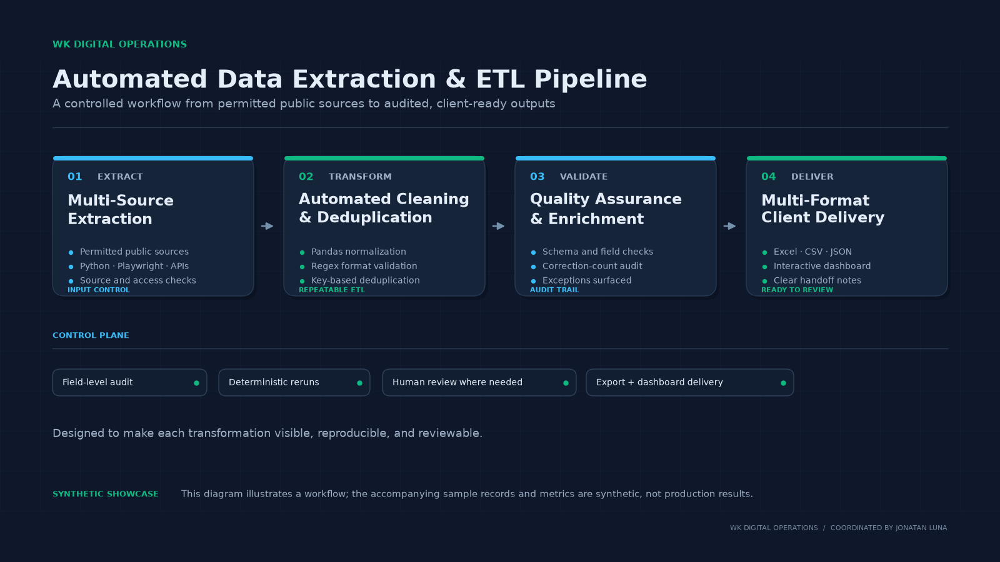
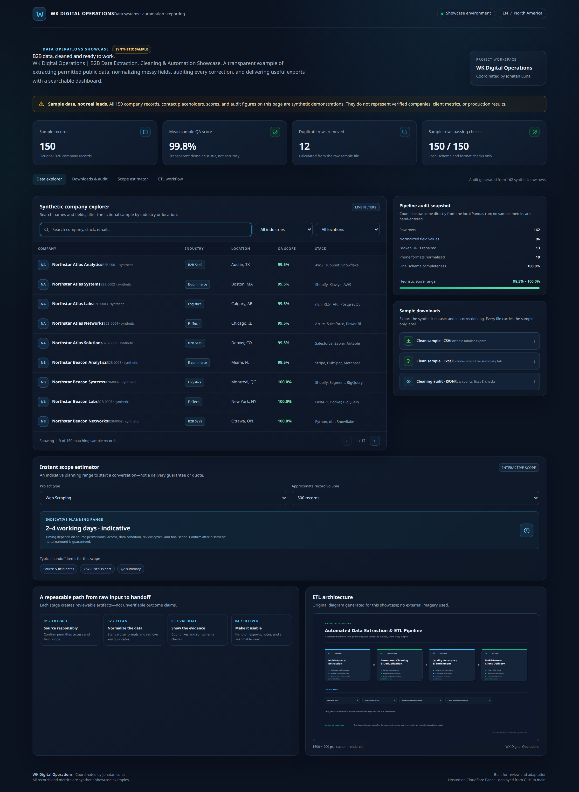

# WK Digital Operations — B2B Data Automation Showcase


**A reproducible, synthetic demonstration of data extraction workflows, Pandas cleaning, audit reporting, spreadsheet delivery, and a searchable client-facing dashboard.**

> **Synthetic sample notice.** The 150 company records, names, websites, email addresses, phone placeholders, quality scores, correction counts, and validation results in this repository are generated examples. They are not real leads, verified companies, client data, production metrics, or claims about completed customer work. No real company directory or private personal data was used. All sample websites and email domains use the reserved `.example` namespace; phone placeholders use the reserved North American `555-0100`–`555-0199` range.

**WK Digital Operations · Coordinated by Jonatan Luna**

## Preview



Live dashboard: **https://wk-data-automation-showcase.pages.dev/**. The preview below is a browser rendering of the same static dashboard bundle.



## What this demonstrates

- A deterministic Python/Pandas ETL pipeline that reads a deliberately messy raw CSV, normalizes fields, deduplicates by `Company_ID`, scores the retained sample using a documented heuristic, and writes an audit report.
- CSV, JSON, and formatted Excel exports. The workbook includes a synthetic-data warning and an executive-summary tab.
- A responsive, dark executive-style dashboard with live search, industry and location filters, computed KPIs, direct file downloads, and an indicative scope estimator.
- A custom 1600 × 900 architecture diagram drawn with Matplotlib. The diagram and dashboard use original project-authored CSS/SVG/graphics; no third-party stock images or externally licensed visual assets are included.

## Current deterministic sample run

The pipeline writes the same calculated audit to `data/cleaning_audit_report.json` and `deliverables/cleaning_audit_report.json`; both are generated from `data/raw_scrape_dump.csv`. The values below are computed by the pipeline, not typed into the dashboard:

| Check or transformation | Result |
|---|---:|
| Raw input rows | 162 |
| Duplicate rows removed by normalized company ID | 12 |
| Final synthetic sample records | 150 |
| Source field values normalized | 96 |
| Website URL values repaired | 13 |
| Phone values normalized | 19 |
| Schema completeness after cleaning | 100.0% |
| Rows passing local sample checks | 150 / 150 |
| Mean heuristic data-quality score | 99.76% |

The score is intentionally labeled a **heuristic sample score**, not factual accuracy or lead verification. For each retained row, the pipeline starts at 100 and subtracts 0.5 points per source field value it normalizes, with a floor of 98. It is a demonstration rule only.

## Run locally

Requirements: Python 3.10 or later.

```bash
python3 -m venv .venv
source .venv/bin/activate
python -m pip install -r requirements.txt
python src/data_pipeline.py --generate-raw
python src/create_architecture_diagram.py
python src/build_static_site.py
python -m http.server 8000
```

Open `http://localhost:8000/` in a browser. The dashboard fetches the generated JSON and audit files from `deliverables/`; serving over HTTP avoids browser `file://` fetch restrictions. The `--generate-raw` option recreates the same 162-row synthetic raw sample deterministically. To rerun the cleaning pipeline without replacing the raw input, use `python src/data_pipeline.py`.

Run automated ETL tests from the repository root:

```bash
python -m unittest discover -s tests -v
```

## Files

```text
.
├── index.html
├── src/
│   ├── data_pipeline.py
│   ├── create_architecture_diagram.py
│   └── build_static_site.py
├── data/
│   ├── cleaning_audit_report.json
│   └── raw_scrape_dump.csv
├── site/                 # Minimal static Pages upload bundle; excludes raw input and source code
├── deliverables/
│   ├── WK_B2B_Cleaned_Leads_Sample.csv
│   ├── WK_B2B_Cleaned_Leads_Sample.xlsx
│   ├── WK_B2B_Cleaned_Leads_Sample.json
│   └── cleaning_audit_report.json
├── assets/
│   ├── etl_architecture_diagram.png
│   ├── etl_architecture_diagram.svg
│   └── dashboard_preview.png
└── tests/
    └── test_pipeline.py
```

## Dashboard and estimator notes

The four dashboard KPIs and audit counts load from the generated JSON artifacts. The search box checks all sample fields; industry and city filters can be combined. The estimator illustrates a planning range based on project type and record volume. Its estimates are indicative only, depend on discovery, source permissions, access, data condition and review, and are **not delivery guarantees or a quote**. No exact delivery commitment is made here.

## Hosting status

The dashboard is published at **https://wk-data-automation-showcase.pages.dev/** through Cloudflare Pages Git integration with this repository's `main` branch. Cloudflare serves the prebuilt `site/` directory with framework preset **None** and no build command. After changing the dashboard or its download artifacts, run `python src/build_static_site.py`, commit the updated bundle, and push to `main`. Production deployments are enabled; preview-branch deployments and PR comments are disabled. No manual file upload is required.

GitHub Pages remains intentionally disabled. The public GitHub repository is the source and downloadable-artifact location, not the site's web host. Live validation confirmed HTTP 200, computed KPIs, search, combined filters, the indicative estimator, all three download links, the 1600 × 900 diagram, and a 390 px responsive layout without horizontal overflow.

## Data handling and visual assets

All records are synthetic and labeled `SYNTHETIC_SAMPLE` in the raw and cleaned exports. The pipeline uses placeholder-only `.example` domains and reserved-format telephone numbers. The architecture image is generated by the included Python script, and the dashboard's brand mark and icons are inline SVG/CSS created for this project; no external stock-image licenses are relied on. The page includes a Tailwind CDN utility script as requested, while the visual styling is authored locally so it remains readable when that CDN is unavailable.

---

**WK Digital Operations · Coordinated by Jonatan Luna**
